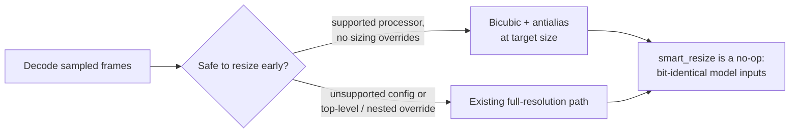

## Hi there 👋

# Chandu Vemula

**Inference infrastructure · performance engineering · deterministic systems**

*Where models meet machines: memory, latency, determinism, and proof that an optimization worked.*

[Portfolio](https://chanduweb.vercel.app) · [LinkedIn](https://linkedin.com/in/pace1304)

---

## Focus

| Domain | Direction |
|---|---|
| **LLM inference** | Multimodal preprocessing, host-memory behavior, runtime efficiency in vLLM |
| **Low-latency systems** | Deterministic C++20, order-book mechanics, replayable execution |
| **Runtime intelligence** | Telemetry → prediction → guarded action → measured verification |
| **Computing systems** | Processor architecture, wireless PHY/DSP, hardware/software interaction |

---

## Open-source contribution

### [vllm-project/vllm #61096](https://github.com/vllm-project/vllm/pull/61096) · *open, under review*
**Resize Qwen3-VL video frames during decoding to reduce peak host memory** · fixes [#60985](https://github.com/vllm-project/vllm/issues/60985)

- Resize settings are derived from the video processor config, so nothing is hard-coded.
- A review comment exposed that sizing overrides nested under `videos_kwargs` bypassed the guard. I fixed it and added regression tests.
- Synthetic 720p benchmark: frame-buffer memory **13.18 → 2.11 MiB**. End-to-end server memory and GPU decode paths are **not yet benchmarked**.

---

## Selected systems

### [ApexHFT](https://github.com/IamChandu114/ApexHFT-Deterministic-Tick-to-Trade-Simulator-in-C-20) · C++20
A deterministic matching-engine simulator: price-time priority, integer ticks, pre-trade risk controls, exact event/OMS replay. It is offline by design, and the README lists its non-goals.

| Verification | Result |
|---|---|
| Test suite (Debug / ASan+UBSan / Release) | 97 / 97 in each configuration |
| Differential fuzzing vs. an independent reference book | 100,000 operations, fixed seed |
| Sanitizer defects | 0 |

**Known limit:** a 1,000,000-operation differential run was interrupted by cumulative O(N²) cancellation cost under concentrated depth. This is documented in the repo and is the next thing to fix.

### [AstraOS](https://github.com/IamChandu114/AstraOS-Autonomous-Runtime-Intelligence-Platform) · Python
A runtime intelligence platform with one loop: **predict → decide → optimize → verify**. It forecasts resource pressure from real host telemetry and acts only inside explicit guardrails. Each intervention is measured before and after and carries rollback metadata. Simulated components are labelled as simulated.

### [WaveCore X](https://github.com/IamChandu114/WaveCore-X-5G-6G-Signal-Engineering-Platform) · TypeScript
An interactive platform for PHY/DSP experimentation: modulation, OFDM, channel modeling, equalization, and BER/SER/EVM analysis. [Live](https://wavecore-x-website.vercel.app)

---

## Engineering standards

1. A claim covers only what was measured.
2. Determinism is a testing tool.
3. Optimizations ship with evidence and a path back.
4. Non-goals are documented.

---

Open-source contributions are made independently and imply no affiliation with the projects' maintainers or sponsors.
<!--
**IamChandu114/IamChandu114** is a ✨ _special_ ✨ repository because its `README.md` (this file) appears on your GitHub profile.

Here are some ideas to get you started:

- 🔭 I’m currently working on ...
- 🌱 I’m currently learning ...
- 👯 I’m looking to collaborate on ...
- 🤔 I’m looking for help with ...
- 💬 Ask me about ...
- 📫 How to reach me: ...
- 😄 Pronouns: ...
- ⚡ Fun fact: ...
-->
